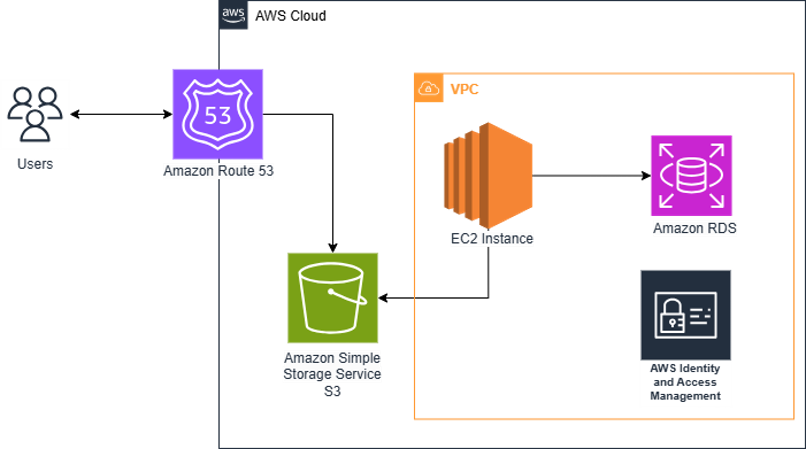

# ☁️ AWS Cloud Based Student Data Management System ☁️

> A cloud-native prototype designed to replace legacy, on-premise university systems with a scalable, secure, and globally accessible solution on AWS.

---

### 🎯 The Challenge: Legacy Systems in Education

In today's digital world, many universities are held back by **outdated, on-premise, or manual** Student Information Systems (SIS). These systems often lead to **operational bottlenecks**, data silos, and a **frustrating experience** for both students and staff. They lack the flexibility and accessibility needed for modern, remote-friendly education.

---

### 🚀 The Solution: A Cloud-Native Prototype

This project serves as a **blueprint for universities** looking to **migrate from their rigid, on-premise infrastructure** to a flexible, decoupled cloud environment. It's a fully functional CRUD application demonstrating how to build a modern SIS that is efficient, scalable, and **globally accessible**.

---

### 📸 Live Demo

The application was deployed and accessible at **ltka21.online**.

---

### 🏗️ Cloud Architecture

Here's a visual representation of the decoupled cloud architecture:

  
*Diagram illustrating the interaction between AWS services for the Student Data Management System.*

The infrastructure uses a decoupled model where each AWS service solves a specific real-world problem.

| Service | Role & Purpose |
| :--- | :--- |
| 🖥️ **Amazon S3** | **Frontend Hosting:** The **ReactJS** user interface is hosted on S3. This provides a durable, cost-effective, and globally accessible entry point for users, completely decoupled from the backend. |
| ⚙️ **Amazon EC2** | **Backend API Server:** A **Spring Boot (Java)** API runs on an EC2 instance, providing the flexible compute power needed to handle business logic. It can scale independently of the frontend to meet demand. |
| 🗃️ **Amazon RDS** | **Managed Database:** An RDS instance manages the **MySQL** database, handling complex tasks like backups, patching, and security. This ensures student data is stored reliably and securely. |
| 🌐 **Amazon Route 53** | **DNS Management:** Route 53 provides reliable DNS routing, ensuring high availability and directing traffic to the application's frontend. |
| 🛡️ **Amazon IAM** | **Security & Access Control:** IAM enforces strict access policies, ensuring that sensitive student data is protected and that users and services operate under the principle of least privilege. |

---

### 🛠️ Tech Stack & Tools

---

### 📈 Impact & Key Outcomes

This project successfully demonstrates a practical path for modernizing educational IT.

- ✅ **Provided a Blueprint for Migration:** Created a working model for integrating core AWS services to replace monolithic, on-premise systems.
- ✅ **Enhanced Global Accessibility:** Built a web platform that can be securely accessed from any location, supporting remote students and staff.
- ✅ **Improved Scalability & Efficiency:** Designed an elastic architecture that can scale to meet demand, from quiet periods to peak registration times.
- ✅ **Strengthened Security:** Implemented security best practices using IAM to manage access to sensitive student data.
